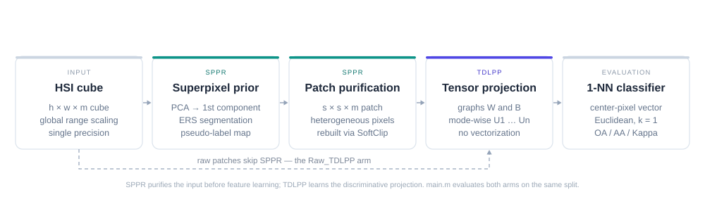
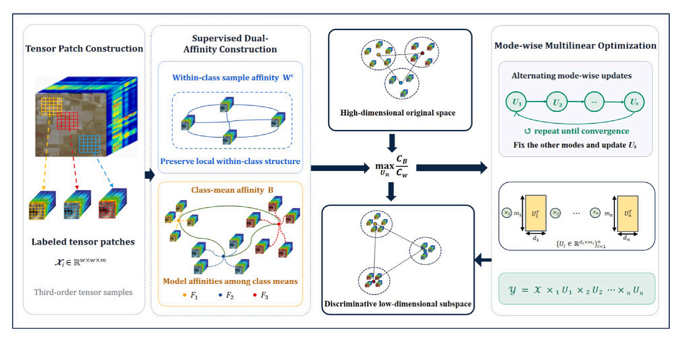
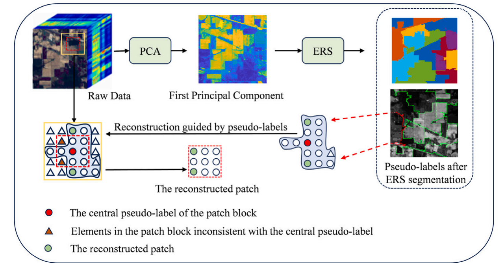

# Semantic-purified tensor discriminant manifold learning for hyperspectral image classification

<table>
<tr>
<td width="180" valign="middle">

</td>
<td valign="middle">
This is my first TOP journal paper in Q1 during my PhD study. There may inevitably be some imperfections. I welcome discussions and any constructive comments.<br>
Contact: 1281538933@qq.com
</td>
<td width="180" valign="middle">

</td>
</tr>
</table>

Minimal MATLAB implementation of **Semantic-purified tensor discriminant manifold learning for hyperspectral image classification** (T. Zhang, L. Zeng, F. Wang, *Pattern Recognition* 184 (2027) 115271).

This package contains only the two proposed components: tensor discriminant locality preserving projection (TDLPP) and superpixel-guided patch purification reconstruction (SPPR). It evaluates raw TDLPP and SPPR + TDLPP on the same training/test split. 

**License:** the authors' MATLAB code is MIT, but this package bundles ERS, which is licensed for **non-commercial use only**. The package as a whole is therefore limited to non-commercial use. See [License](#license) and [THIRD_PARTY_NOTICES.md](THIRD_PARTY_NOTICES.md) before reuse.

## Method

The framework couples two components that act at different stages of the pipeline. **SPPR purifies the input representation** before feature learning; **TDLPP learns a discriminative tensor projection** on top of it. The two are complementary, which is why `main` always runs both arms — raw patches and purified patches — on the same split and reports the paired gain. The two components are decoupled for standalone usage. For dimensionality reduction tasks, TDLPP alone is sufficient for feature extraction.



### TDLPP



A training patch $`\mathcal{X}_i^{c}\in\mathbb{R}^{w\times w\times m}`$ of class $`c`$ is projected with one matrix per mode, $`\mathcal{Y}_i^{c}=\mathcal{X}_i^{c}\times_{1}U_1\times_{2}U_2\cdots\times_{n}U_n`$ with $`U_k\in\mathbb{R}^{d_k\times m_k}`$ and $`d_k<m_k`$, and TDLPP maximizes

```math
\max_{U_1,\ldots,U_n}\;\frac{\sum_{u,v=1}^{C}\lVert\mathcal{M}_u-\mathcal{M}_v\rVert_F^{2}\,B_{uv}}{\sum_{c=1}^{C}\sum_{i,j=1}^{n_c}\lVert\mathcal{Y}_i^{c}-\mathcal{Y}_j^{c}\rVert_F^{2}\,W_{ij}^{c}},
```

where $`\mathcal{M}_u`$ is the mean tensor of class $`u`$ in the projected space. Both affinity graphs are fully connected heat kernels, so no $`K`$-nearest-neighbour truncation is involved:

```math
W_{ij}^{c}=\exp\left(-\frac{\lVert\mathcal{X}_i^{c}-\mathcal{X}_j^{c}\rVert_F^{2}}{t_1}\right),\qquad B_{uv}=\exp\left(-\frac{\lVert\mathcal{F}_u-\mathcal{F}_v\rVert_F^{2}}{t_2}\right),
```

with $`\mathcal{F}_u`$ the class-mean tensor in the original space. $`B_{uv}`$ is larger for class pairs whose means are closer, so maximizing the numerator concentrates the effort on the classes that are easiest to confuse. The widths are not tuned per dataset: $`t_1`$ and $`t_2`$ default to the mean pairwise distance of the training samples and of the class means.

### SPPR



The pseudo-label map comes from PCA (first component) followed by ERS segmentation with $`K=\lfloor hw/A_s\rfloor`$, $`A_s=800`$, $`\lambda=0.5`$ and $`\sigma=5`$; no ground truth is used. For a patch centred at $`\mathbf{p}_0`$ with centre pseudo-label $`\tilde{y}_0`$:

**Step 1 — Heterogeneous positions.** Position $`\mathbf{p}`$ is flagged when its pseudo-label differs from $`\tilde{y}_0`$; flagged positions are candidates for reconstruction, the rest are kept unchanged.

**Step 2 — Candidate set.** Every position of the whole scene carrying the pseudo-label $`\tilde{y}_0`$ is a candidate, minus the patch's own homogeneous positions, which would only duplicate what the patch already has.

**Step 3 — Suitability.** For a flagged position $`\mathbf{p}_h`$ and a candidate $`\mathbf{p}'`$, the spectral distance to the centre pixel $`d_{\mathrm{spec}}(\mathbf{p}',\mathbf{p}_0)`$ and the spatial distance to the flagged position $`d_{\mathrm{spa}}(\mathbf{p}',\mathbf{p}_h)`$ are combined as

```math
s(\mathbf{p}',\mathbf{p}_h)=\frac{d_{\mathrm{spa}}(\mathbf{p}',\mathbf{p}_h)}{\exp\left[-d_{\mathrm{spec}}(\mathbf{p}',\mathbf{p}_0)\right]},
```

so spectral dissimilarity penalizes a candidate multiplicatively and no extra trade-off weight is introduced.

**Step 4 — Assignment and reconstruction.** Flagged positions are visited in a fixed row-wise order; each takes the lowest-cost candidate still unused in this patch, and once the pool is exhausted the remaining positions keep their original spectra. The replacement is a clipped interpolation rather than a hard copy,

```math
\begin{aligned}
\mathcal{X}_i^{\mathrm{rec}}(\mathbf{p},:)&=\mathcal{X}_i(\mathbf{p},:)+\alpha_{i,\mathbf{p}}\left[\mathbf{x}^{\ast}(\mathbf{p})-\mathcal{X}_i(\mathbf{p},:)\right],\\[4pt]
\alpha_{i,\mathbf{p}}&=\min\left\{1-\rho_i,\ \frac{\lVert\mathcal{X}_i(\mathbf{p},:)-\mathbf{x}_0\rVert_2}{\lVert\mathbf{x}^{\ast}(\mathbf{p})-\mathcal{X}_i(\mathbf{p},:)\rVert_2+\varepsilon}\right\},
\end{aligned}
```

where $`\rho_i`$ is the fraction of flagged positions in the patch. The weight is capped at $`1-\rho_i`$, so the more heterogeneous a patch is, the more conservative its correction, and $`\alpha=0`$ keeps the original spectrum.

### Paper to code

| Paper element | Where |
|---|---|
| Eq. (2) objective, Algorithm 1, mode-wise update (Eqs. 5–9) | `core/tdlpp_fit.m` |
| Eq. (4) within-class graph `W` and class-mean graph `B` | `core/tdlpp_graph.m` |
| PCA + ERS pseudo-label map | `core/sppr_segment.m`, `core/sppr_prepare.m` |
| Eqs. (10)–(15) mask, candidate set, cost, greedy assignment | `core/sppr_reconstruct.m` |
| Eq. (16) SoftClip interpolation | `core/sppr_reconstruct.m` |
| Eqs. (17)–(21) CLCR diagnostics | not included |

## Scope

Included: TDLPP solver, SPPR reconstruction, ERS + PCA helpers, paired evaluation, invariant tests.

Not included: comparison methods (LPP, DLPP, GLSAPP, TLPP, MTLPP, WMTLPP, DS2-TLPP), the window/dimension sweeps of Fig. 4 and Table 2, the CLCR patch-purity diagnostics of Section 3.2 (Figs. 7-8), the manuscript train/test splits, and the datasets.

## Requirements

- MATLAB R2023b and Statistics and Machine Learning Toolbox (`fitcknn`). Tensor Toolbox and a GPU are not required.
- ERS segmentation: `third_party/ers/mex_ers.mexw64` is a **Windows x64** binary and cannot be loaded on Linux or macOS. On those platforms `main` tries to build a MEX from `third_party/ers/source/` before segmenting, which requires a configured C++ compiler (`mex -setup C++`). Builds on other platforms have not been verified here, and a rebuild can yield a slightly different segmentation from the shipped binary.

## Run

Open MATLAB in this folder. There is one user entry point:

```matlab
main;                         % Small synthetic example, no external data or ERS
main('Indian', 'data');       % One paired trial on real data
main('Salinas', 'data', 'results', 1001:1010); % Ten paired trials
main('Salinas', 'data', 'results', [1001 1003], 'data/splits/Salinas_splits.mat');
                              % Reuse saved train/test indices instead of resampling
```

Saved splits live in `data/splits/<Dataset>_splits.mat` and hold a struct array `S`
with `seed`, `train_linear`, `test_linear` (original-scene linear indices) and
`provenance`. `main` uses that file automatically when it is present and the
requested seed is in it; seeds missing from the file fall back to `make_split`.
Pass the fifth argument to point at a different file. Saved splits are validated
against the label map (range, duplicates, train/test overlap, labelled centres).

The package ships `data/splits/<Dataset>_splits.mat` for all four datasets, each
covering seeds 1001, 1003, 1005, 1007 and 1009.
Their `meta` record stores the relative cube/label path and the SHA-256 of the
label file, so the partitions can be audited against the datasets; splits for
any other seed are generated on the fly by `make_split`.

Supported real datasets are `Indian`, `Salinas`, `HongHu`, and `Houston`. To run all four datasets with ten splits and aggregate the numbers:

```matlab
reproduce_tables;                                  % data/, results/, seeds 1001:1010
reproduce_tables('D:/hsi', 'out', [1001 1002]);    % custom roots, two splits
```

Quick self-check without any dataset (a few seconds):

```matlab
addpath('tests'); test_invariants;
```

The tests check candidate uniqueness, exhaustion handling, the SoftClip magnitude bound, symmetric padding, candidate membership, graph structure and the solver history contract.

## Data

Datasets are not redistributed here: together they are about 600 MB and their providers' terms do not allow us to repackage them. Put them under `data/` following [`data/README.md`](data/README.md), which lists the exact file names, sizes and SHA-256 checksums of the copies used for the reported runs. The paths below are relative to the `data_root` argument (`data` above); any other folder with the same layout works. `data/` is ignored by git except `data/splits/` and that README, so a local copy of the datasets is never committed.

| Dataset | Cube file : variable | Label file : variable |
|---|---|---|
| Indian | `01_Indian_Pines/Indian_pines_corrected.mat` : `indian_pines_corrected` | `01_Indian_Pines/Indian_pines_gt.mat` : `indian_pines_gt` |
| Salinas | `02_Salinas/Salinas_corrected.mat` : `salinas_corrected` | `02_Salinas/Salinas_gt.mat` : `salinas_gt` |
| HongHu | `WHU-Hi-HongHu/WHU_Hi_HongHu.mat` : `WHU_Hi_HongHu` | `WHU-Hi-HongHu/WHU_Hi_HongHu_gt.mat` : `WHU_Hi_HongHu_gt` |
| Houston | `Houston/Houston.mat` : `Houston` | `Houston/Houston_gt.mat` : `Houston_gt` |

Cubes must be H-by-W-by-B numeric arrays; label maps must be H-by-W nonnegative integer arrays, with zero for unlabeled pixels. Houston expects a combined label map for random sampling, rather than the provider's predefined train/test partition.

Sources: Indian Pines and Salinas are distributed by the Computational Intelligence Group, University of the Basque Country. WHU-Hi-HongHu is distributed by the RSIDEA group, Wuhan University. Houston 2013 is distributed by the IEEE GRSS Data Fusion Contest and requires a request.

## Configuration and output

Dataset settings are in the local `configuration` function in `main.m`:

| Dataset | Window | Spectral output dimension | Training samples | Testing samples |
|---|---|---:|---|---|
| Indian | 11 × 11 | 50 | Per-class floor(5%), minimum 10 | Remaining labeled pixels |
| Salinas | 11 × 11 | 50 | Per-class floor(1%), minimum 10 | Remaining labeled pixels |
| HongHu | 11 × 11 | 20 | 50 per class | 300 per class |
| Houston | 11 × 11 | 15 | Per-class floor(5%), minimum 10 | Remaining labeled pixels |

Preprocessing uses global range scaling and single-precision patches; HongHu additionally uses full-scene PCA to 80 bands. Training and test partitions are centered separately. ERS uses target area 800, lambda 0.5 and sigma 5. Classification uses Euclidean 1-NN (`fitcknn`, no standardization). The TDLPP solver retains the original update order, `lambda > eps` eigenvalue selection and stopping settings (0.005, at most 50 iterations).

Each call creates a folder `<dataset>_<timestamp>` under `results/`. It saves the configuration, split indices, models, predictions, true labels, per-class accuracy, confusion matrices and the summary table. In `trials.csv`, OA/AA/Kappa use the 0–1 scale; `gain_pp` uses percentage points. Optional return values are `[metrics, run_dir] = main(...)`.

## Reproduction caveats

Three differences are deliberate and must be considered before comparing with the paper:

- **Segmentation is recomputed from the scene**, while the manuscript runs used a cached pseudo-label map that is not part of this release. Against that cached map, the recomputed segmentation has an adjusted Rand index of 0.99995 (Indian), 0.99125 (HongHu), 0.70564 (Salinas) and 0.78789 (Houston); one Salinas paired trial changes by about 0.1 percentage points OA.
- **Splits are regenerated** from the requested seeds. They are not the unpublished manuscript splits, so per-class accuracies and OA differ even with identical settings.
- **Three protocol details are not specified in the paper**: a minimum of ten training samples per class, separate centering of the training and test partitions, and full-scene PCA to 80 bands for HongHu.

The evaluation is transductive: full-scene spectra participate in normalization, PCA and segmentation; random-pixel train/test patches may overlap spatially. Ground-truth labels do not enter SPPR reconstruction; they are used only for scoring.

Because of these three differences this release does not reproduce the manuscript tables exactly. It reproduces the method, not the archived run.

## Files

- `main.m`: data loading, configuration, paired evaluation and saving.
- `reproduce_tables.m`: ten splits on all four datasets, aggregated CSV.
- `tests/test_invariants.m`: SPPR and TDLPP invariants, no data needed.
- `core/`: TDLPP, SPPR, preprocessing and patch extraction.
- `docs/figures/`: pipeline overview, plus the TDLPP and SPPR framework figures from the paper (see [THIRD_PARTY_NOTICES.md](THIRD_PARTY_NOTICES.md)).
- `data/README.md`, `data/splits/`: dataset layout and checksums, plus the fixed train/test indices shipped for Salinas and Indian.
- `third_party/`: ERS and the legacy PCA helpers, with original author notices.

## Citation

```bibtex
@article{zhang2027semantic,
  title   = {Semantic-purified tensor discriminant manifold learning for
             hyperspectral image classification},
  author  = {Zhang, Tao and Zeng, Limin and Wang, Fang},
  journal = {Pattern Recognition},
  volume  = {184},
  pages   = {115271},
  year    = {2027}
}
```

## License

MIT for the files authored by the paper's authors; see `LICENSE`. Files under `third_party/` keep their original terms, and ERS is licensed for non-commercial use only, so this package as a whole is limited to non-commercial use. See [THIRD_PARTY_NOTICES.md](THIRD_PARTY_NOTICES.md).
